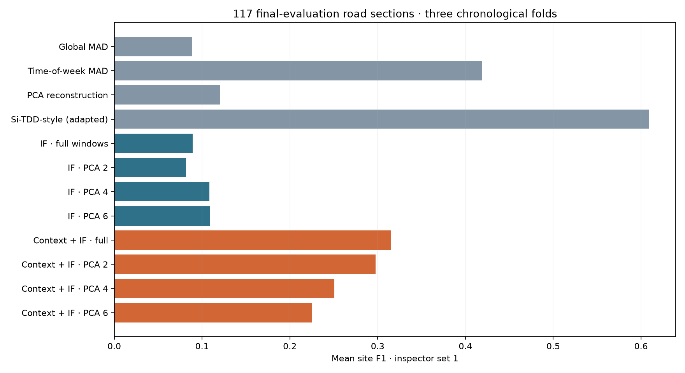

# Traffic time-series anomaly detection — IFN737

A reproducible classical benchmark for identifying unusual observed traffic-volume patterns in AnoLT. It tests how weekday/time-of-day context and principal component analysis (PCA) affect detection on individual road sections.

The repository name reflects the wider QML research direction. **The implemented phase is classical.** Quantum integration is future work, following a validated classical baseline.

## Results

The frozen experiment uses 30 development sections and 117 final-evaluation sections, three expanding chronological folds and three Isolation Forest seeds. Mean site F1 below uses inspector label set 1; seeds and folds are averaged within each section before sections are averaged equally.

| Method | Mean F1 |
|---|---:|
| Adapted Si-TDD-style baseline | **0.609** |
| Time-of-week MAD | 0.419 |
| Contextual Isolation Forest, full window | 0.315 |
| Contextual Isolation Forest, two-component PCA | 0.298 |
| Raw Isolation Forest, full window | 0.089 |

Temporal context improves this benchmark substantially. Two-component PCA does not improve the contextual forest's mean F1 here. The stronger adapted nearest-neighbour baseline remains visible rather than treating a more complex model as automatically better.



These are historical volume-pattern results, not crash-detection accuracy. Read the [results and uncertainty summary](docs/RESULTS.md), [research alignment](Research_Alignment.md) and [historical full-output recheck](Recheck_2026-11-19.md). The [HTML analysis](report.html) can be downloaded and opened locally; GitHub does not render it as a hosted website.

The repository includes source code, the frozen protocol, a notebook and compact derived results/figures. Raw source CSVs, trained weights, detailed NPZ score arrays, resumable job caches and private course documents are excluded. Their absence is intentional; generate the data and models using the commands below.

[Repository setup and verification](docs/REPOSITORY_SETUP.md) · [Model card](MODEL_CARD.md)

## Learning curves: MAE, training time and RAM

[Measured curves and protocol](results/learning_curves/README.md) show **MAE vs T**, **training seconds vs T** and **peak RAM vs T**, where T is 7–140 calendar days. They also include anomaly F1/precision/recall/false alerts and companion forecast RMSE/WAPE/R². There are 84 isolated CPU trials on development section 0185-E, with fixed validation/test periods and three seeds/repetitions. Shading shows observed min–max, not confidence intervals. MAE belongs to a separate next-interval LSTM forecasting task; the original anomaly-detection results remain unchanged.

```sh
python -m pip install -r requirements-forecast.txt
python fetch_data.py
python learning_curves.py --out results/learning_curves_local
python plot_learning_curves.py --results results/learning_curves_local
```

PyTorch is optional for the anomaly project and required for these companion forecast trials. Use the [official installation selector](https://pytorch.org/get-started/locally/) for a build suitable for your platform; CPU-only Linux/Windows builds avoid unnecessary GPU dependencies. View committed figures/CSVs without installing it. Use a new `--out` folder for a fresh measurement run on another software/hardware environment.

## Quick start

Use Python 3.12 or 3.13. From a clone of this repository:

```sh
python3 -m venv .venv
source .venv/bin/activate
python -m pip install -r requirements.txt
python -m unittest discover -p 'test_*.py'
python fetch_data.py
python train_site.py --data data/0185-E.csv --out models/0185-E
python detect.py --model models/0185-E/detector.joblib --history data/0185-E.csv
```

On Windows PowerShell, create and use the environment without changing execution policy:

```powershell
py -3.12 -m venv .venv
& ".\.venv\Scripts\python.exe" -m pip install -r requirements.txt
& ".\.venv\Scripts\python.exe" -m unittest discover -p 'test_*.py'
& ".\.venv\Scripts\python.exe" fetch_data.py
& ".\.venv\Scripts\python.exe" train_site.py --data data/0185-E.csv --out models/0185-E
& ".\.venv\Scripts\python.exe" detect.py --model models/0185-E/detector.joblib --history data/0185-E.csv
```

`requirements.txt` is the installation list. `environment-lock.txt` records the original full workspace environment, including separate forecasting dependencies, and is retained for provenance rather than minimal installation.

Raw data, fitted models and detailed score caches are generated locally rather than stored in Git. `fetch_data.py` downloads the pinned AnoLT snapshot and verifies the 147 CSV hashes. It uses `curl`, available on current macOS and Windows installations. Initial dependency installation and data acquisition need internet; subsequent analysis of the locally acquired data can run offline. The tests use synthetic fixtures and need neither raw AnoLT CSVs nor trained weights.

## Download trained models

[Release v1.0.0](https://github.com/BhanuTevathiaN12502791/QML-Time-Series-Analysis-IFN737-/releases/tag/v1.0.0) provides `trained-models.zip` and `SHA256SUMS`. Extract the archive into the repository root after installing dependencies and fetching the data. It contains fitted IF and adapted nearest-neighbour examples for **0185-E only**, not models for every section. See [MODEL_CARD.md](MODEL_CARD.md).

## Train and score another section

```sh
python train_site.py --data data/2414-E.csv --out models/2414-E
python detect.py --model models/2414-E/detector.joblib --history data/2414-E.csv --out detections_2414_E.csv
```

The same code runs across sections, with separately fitted weights and calibration thresholds. It does not use one universal set of weights. For a generically named history file, supply `--site 2414-E` to assert the intended section.

To use the adapted nearest-neighbour baseline:

```sh
python train_site.py --model sitdd_adapted --data data/2414-E.csv --out models/2414-E_sitdd
python detect.py --model models/2414-E_sitdd/detector.joblib --history data/2414-E.csv
```

The default forest representation was selected using development validation data. `--model` also accepts the raw/contextual forest variants, PCA widths 2/4/6, `global_mad`, `time_of_week_mad` and `pca_reconstruction`.

## Data and detection meaning

Inference needs `Date` and `Volume` columns, ordered unique quarter-hour timestamps and finite nonnegative volumes. Eight consecutive readings form each window: the current observed interval and seven prior readings. Gaps invalidate crossing windows; valid zeros remain zero. This detects after observing an interval, rather than forecasting a future count.

Training/calibration additionally needs binary `label_set_1` and `label_set_2`. In AnoLT these are two inspector annotation sets. Primary model fitting excludes labels, while threshold calibration uses validation set-1 labels; set-2 evaluation reuses the thresholds. The complete calibrated procedure is therefore label-assisted, not wholly unsupervised. Scores are not probabilities, and an anomalous volume pattern does not establish its cause.

## Protocol and reproduction

The allocation and choices are recorded in `protocol.json`, `protocol.sha256` and `selected_parameters.json`:

- Source snapshot: `d2e927425b40235d881905ba6881112bcc017e43`.
- Fit/validation/test endpoints: 40/55/70%, 55/70/85%, 70/85/100% of each section's ordered rows.
- Fit context statistics, scaling, PCA and forests using training observations only.
- Use matched detector settings, seeds, folds and eligible test timestamps when changing representations.
- Select validation thresholds for pointwise F1, with ties preferring fewer alerts; freeze them for both test annotation sets. No point adjustment is used.
- Compare full eight-reading windows with PCA widths 2, 4 and 6, with/without time-of-week residualisation.
- Save site/fold/seed metrics, paired site-bootstrap intervals, normal-only sensitivity, error groups and isolated cost measurements.

The synthetic regression tests run directly after dependency installation, without downloading AnoLT or training a model:

```sh
python -m unittest discover -p 'test_*.py'
```

To execute the complete frozen experiment and regenerate analyses:

```sh
python run_all.py --fetch
```

`verify_results.py` is the **full-output** audit. It requires the raw data, locally trained example checkpoints and detailed per-site NPZ/CSV outputs produced by the complete reproduction. The compact committed tables and archived `results/verification.json` record the earlier full local audit; they cannot by themselves reproduce every check.

The full run performs thousands of per-section model fits and can take several minutes or longer depending on hardware. It uses three workers by default. Large local outputs are ignored by Git. Completed jobs are reused only when cache fingerprints and output hashes match; changed inputs, code or software versions require a fresh result copy. Run the isolated benchmark after other experiments finish for comparable timing.

## Notebook

The notebook is optional. Install its interactive dependency separately:

```sh
python -m pip install jupyterlab
jupyter lab experiment.ipynb
```

Open it from the repository root. Install dependencies, acquire data and train the example model before executing its input/inference cells. The committed compact result tables and figures support the results walkthrough. Cells that verify or regenerate the full experiment require the full reproduction outputs. `environment-lock.txt` records the original full local environment, including unrelated packages; `requirements.txt` is the project's minimal installation list.

## Limits

Final sections are excluded from new global selection but use their own earlier observations and validation labels for local fitting/calibration. This evaluates a fixed procedure rather than zero-shot transfer. Test periods are disjoint within a section, but histories expand and geographically related directions may span allocation groups. Shared-ID-prefix sensitivity does not prove geographic independence.

The study evaluates one historical labelled volume benchmark. External-city generalisation, live monitoring, verified crash association, spatial models and quantum performance remain untested. The source algorithm and evaluation differ: the Si-TDD-style implementation adapts same-slot kth-distance scoring to this calibration protocol and does not claim an exact replication of the paper's published scores.

## Attribution

- Taheri Sarteshnizi et al. (2026), *On the applicability of time series anomaly detection methods to real-world traffic volume data*, Transportation Research Part C, 184, 105536. [Paper](https://doi.org/10.1016/j.trc.2026.105536).
- [AnoLT data and source snapshot](https://github.com/imaantaheri/AnoLT/tree/d2e927425b40235d881905ba6881112bcc017e43). The source data and upstream code retain their original terms; this repository does not assert a new licence over them.
- Methods use [scikit-learn Isolation Forest](https://scikit-learn.org/stable/modules/generated/sklearn.ensemble.IsolationForest.html) and [PCA](https://scikit-learn.org/stable/modules/generated/sklearn.decomposition.PCA.html).
- IFN737 reports and presentation supplied the research questions and staged classical-to-quantum plan. OpenAI Codex assisted with implementation, execution, verification and reporting. Historical progress claims are not backdated.
