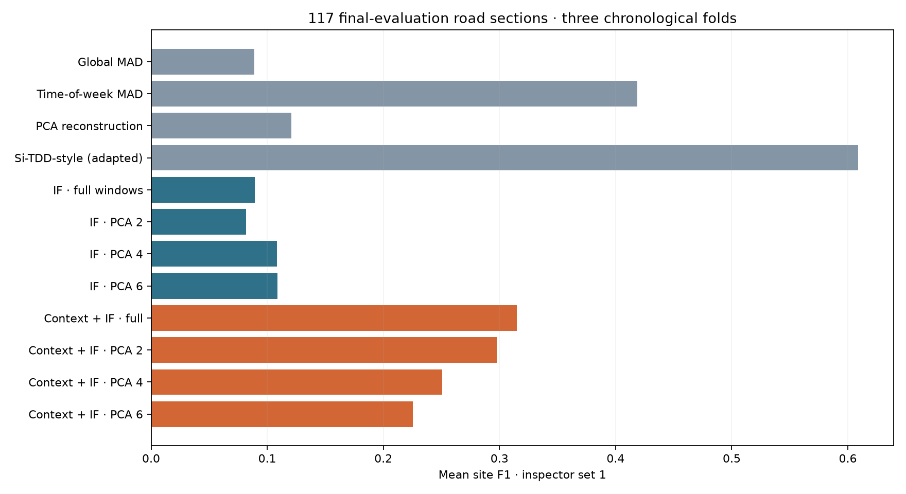

# Classical benchmark results

[Full HTML analysis](../report.html) · [Protocol](../protocol.json) · [Historical audit record](../Recheck_2026-11-19.md)

The research questions concern the contribution of temporal context and PCA to classical detection of unusual traffic-volume observations. They are evaluated on the pinned AnoLT snapshot using 30 development sections, 117 final-evaluation sections and three expanding chronological folds.

## Main comparison

Mean site metrics use inspector label set 1. Forest seeds and folds are averaged within each section, then sections are averaged equally. Thresholds are calibrated using validation set-1 labels and frozen before each test period.

| Method | Mean F1 |
|---|---:|
| Adapted Si-TDD-style baseline | 0.609 |
| Time-of-week MAD | 0.419 |
| Contextual Isolation Forest, full eight-reading window | 0.315 |
| Contextual Isolation Forest, PCA 2 | 0.298 |
| Raw Isolation Forest, full eight-reading window | 0.089 |

The adapted nearest-neighbour baseline is strongest in this comparison. Context improves the full-window forest substantially, while two-component PCA reduces its mean F1 here. This does not imply that compression is always harmful: four- and six-component variants, cost measurements and annotation sensitivity are retained in the detailed result tables.

The paired context effect for full-window IF is +0.2255 F1 (95% site-bootstrap interval +0.2066 to +0.2453). The contextual PCA-2 effect is −0.0173 (−0.0278 to −0.0070). For the latter contrast, the shared-ID-prefix cluster interval spans zero. Its certainty therefore depends on how related directions are grouped. These are descriptive benchmark estimates, not universal superiority claims.

## Verification

The 19 November 2026 recheck verified all 147 source Git hashes, source-to-score timestamps/labels, complete experiment grids and chronological boundaries. All 30,312 metric rows reproduced without mismatches. A fixed sample of 108 refitted models reproduced recorded validation thresholds and test predictions. The 25-test regression suite used in that full local recheck passed. The source-only checkout now uses synthetic test fixtures so tests do not require the excluded dataset or weights.

The complete per-site score archive is generated locally and excluded from Git. `verify_results.py` expects that complete archive after reproduction; compact committed tables alone are not enough to rerun every numerical check.

## Interpretation limits

Final sections are excluded from new global selection but still use local earlier observations and validation calibration. Related directions may span allocation groups. The study therefore evaluates a fixed, locally fitted procedure, not zero-shot transfer or geographic independence. AnoLT annotations concern unusual volume patterns, not confirmed crashes. The Si-TDD-style method adapts the upstream distance definition to this study's calibration protocol; no exact reproduction of published test-optimal paper scores is claimed.

Live response, crash matching, spatial models, external-city validation and QML remain later research stages.
