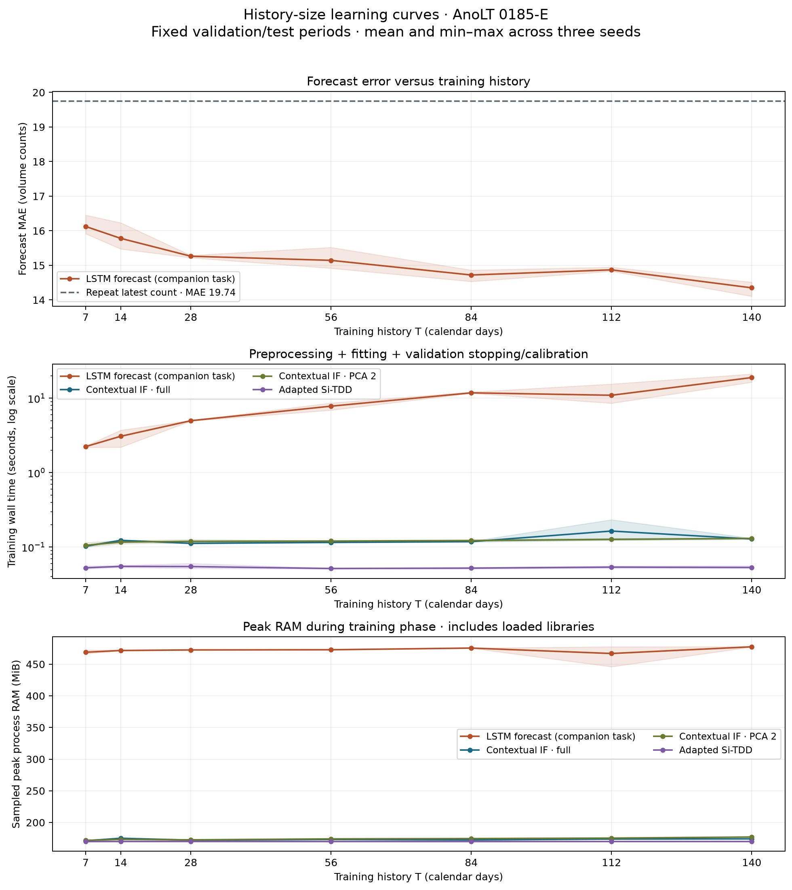

# MAE, training time and RAM versus training history

All three requested Y-axes are provided separately, with **T (calendar training days)** on X. MAE measures next-interval prediction error in original volume-count units. Training time is wall-clock seconds. RAM is process resident memory in MiB (1 MiB = 1,048,576 bytes).

## Protocol

- Section: **0185-E**, an already-used development/pilot section. This is exploratory single-section analysis, not a new 117-site generalisation study.
- T = 7, 14, 28, 56, 84, 112 and 140 trailing calendar days, all ending **2019-07-04 23:45:00**.
- Fixed validation: **2019-07-05 00:00:00** through **2019-08-05 11:45:00**; fixed test: **2019-08-05 12:00:00** through **2019-09-05 23:45:00**.
- Three seeds/repetitions: 17, 42, 91. Lines are means; shading is observed min–max, **not a confidence interval**. Si-TDD is deterministic; its repetitions measure runtime variation.
- Every training input and target lies inside its lookback. Valid zeros remain; gap-crossing windows are excluded. `coverage.csv` records actual observations and equivalent observed days, which differ from calendar T when dates are absent.
- A companion **LSTM(32)** predicts the next volume from 20 preceding readings. Adam 0.001, batch 64, at most 40 epochs, validation-MSE early stopping with patience 7, training-only scaling, nonnegative predictions. Test targets stay fixed across T. Persistence repeats the latest observed count.
- The established contextual IF full/PCA-2 and adapted Si-TDD procedures retain their frozen global settings and validation-only anomaly thresholds. Detection uses the current observation plus seven prior readings. MAE and F1 address separate tasks and are not compared numerically.

## Measurements

Trials run **serially in fresh CPU processes**, in a seeded shuffled order. Training time includes feature/context/scaling preparation, fitting and validation-based early stopping or threshold calibration. It excludes final test inference and file I/O. Initial top-level framework imports occur before timing; lazy optimiser setup inside fitting remains part of the measured pipeline.

RAM is sampled every 2 ms. The training peak is captured before final test prediction. Absolute process RSS includes Python and loaded libraries, so the optional PyTorch forecaster has a larger loaded baseline. The second RAM panel shows additional peak RSS above that baseline. These are sampled peaks, not exact allocation totals; very short transient peaks may be missed. Small timing differences can reflect system load, scheduling and sampling overhead. The CSV inference_seconds field covers validation plus test for the forecaster and test only for detectors; it is diagnostic and is not plotted as a matched latency comparison.

Each procedure is fixed: IF uses 100 trees and max_samples 256, so fitting cost need not grow linearly with T. LSTM epochs vary with validation stopping and are plotted. At seven days the weekday/time-slot profile has only one reference per slot, which can make contextual residuals degenerate; this short-history limitation is retained in the results.

## Companion forecasting means

| training_days | mae | rmse | training_seconds | training_peak_rss_mib | training_extra_rss_mib | epochs |
|---|---|---|---|---|---|---|
| 7.000 | 16.125 | 23.282 | 2.241 | 468.875 | 65.438 | 40.000 |
| 14.000 | 15.781 | 22.810 | 3.082 | 471.667 | 68.094 | 36.000 |
| 28.000 | 15.264 | 22.228 | 4.993 | 472.526 | 68.760 | 40.000 |
| 56.000 | 15.144 | 22.083 | 7.830 | 472.818 | 68.990 | 35.000 |
| 84.000 | 14.721 | 21.507 | 11.833 | 475.479 | 72.198 | 40.000 |
| 112.000 | 14.870 | 21.614 | 10.975 | 466.901 | 74.578 | 27.667 |
| 140.000 | 14.350 | 20.980 | 18.980 | 477.500 | 73.844 | 38.000 |

## Other metrics and files

- `detection_metrics_vs_days.png`: F1, precision, recall, average precision, false-positive rate and false alerts/day (inspector set 1). Set-2 values are also retained in the CSV.
- `forecast_metrics_vs_days.png`: MAE, RMSE, WAPE, R², persistence skill and epochs.
- `runs.csv`: all measured trials; `summary.csv`: means and observed ranges; `coverage.csv`: data coverage; `verification.json`: source/target/metric checks.
- Every figure has PNG and SVG versions. Detailed predictions and epoch histories are generated locally in `trials/`.

The curves describe performance under these fixed settings. More history need not monotonically improve error. Increasing T also introduces older traffic regimes and seasonal composition, so this is not a pure causal experiment on sample count alone. Do not choose a preferred history size using test curves and then present the same test as untouched validation. The original frozen final-site anomaly results remain unchanged.
